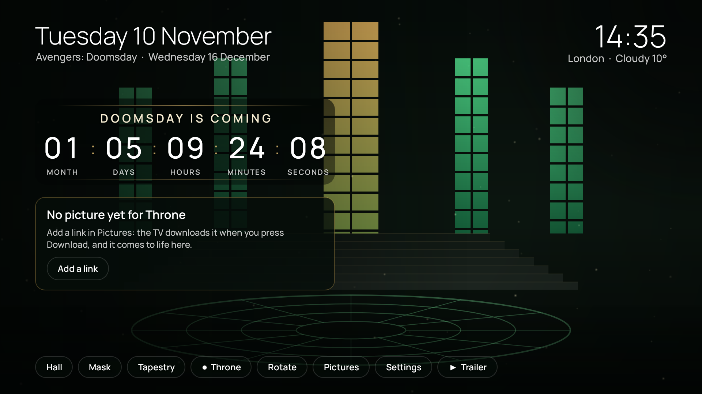
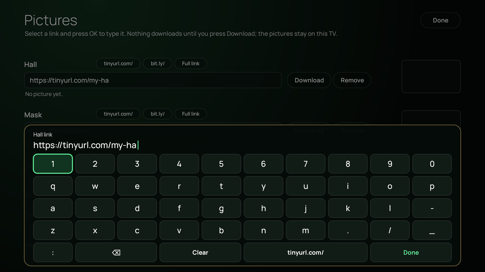
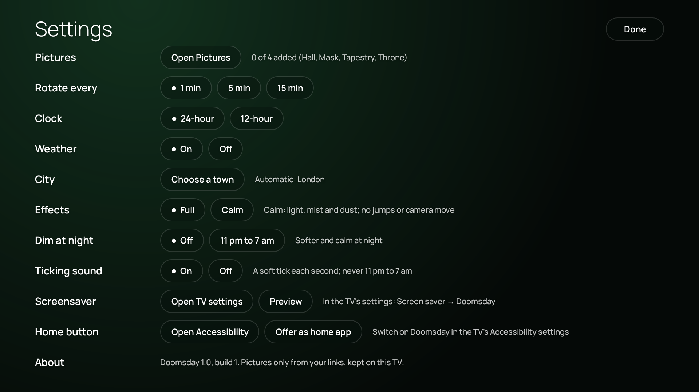

# Doomsday for TV

A countdown to **Avengers: Doomsday** (UK release: Wednesday 16 December 2026) for Google TV,
Android TV and Amazon Fire TV, set on pictures that come alive. You add the pictures yourself,
by link; the app brings them to life with light, mist, drifting dust, green energy and a slow
camera move. Hold OK and something summons itself.

> Not affiliated with or endorsed by Marvel Studios or Disney. No film images are included.
> You add your own pictures, which stay on your TV. See [NOTICE](NOTICE).

## What it does

- **The countdown, in the film's style**: "Doomsday is coming", then months, days, hours,
  minutes and seconds, with rolling digits and a soft green glow on each second. On the day it
  reads "Avengers: Doomsday is here".
- **Today's date, the clock and the weather** along the top.
- **Four picture slots**, Hall, Mask, Tapestry and Throne, plus **Rotate**, which goes through
  the pictures you have.
- **Pictures by link**, typed with the app's own on-screen keyboard. Nothing downloads until you
  press Download, and the pictures stay on your TV.
- **Living pictures**: the bright parts of your picture breathe, mist drifts across, dust hangs
  in the light, and green energy leaps to whatever button you move to.
- **Summon**: hold OK for two seconds. The room darkens, rings of green fire run across the
  floor, a flash, and the countdown spins.
- **Your TV's apps** in a row, one press up from the buttons.
- **Screensaver** (Google TV and Android TV): the countdown and the pictures when the TV is idle.
- **A soft ticking sound**, quiet at night, and a few other settings. That's all: no account,
  no sign-in, nothing tracked.

| Pictures and the keyboard | Settings |
|---|---|
|  |  |

## Install it

The app isn't in an app store. You install the APK yourself (this is called sideloading).

**Google TV / Android TV** (for example Chromecast with Google TV):
1. Install **Downloader** from the Play Store on the TV.
2. Turn on *Settings → System → About → Android TV OS build* (press it 7 times) to enable
   developer options, then *Settings → Apps → Security & restrictions → Unknown sources* and
   allow **Downloader**.
3. In Downloader, enter the link to `doomsday.apk` (from this repo's Releases page) and install.
4. Open **Doomsday** from your apps.

**Amazon Fire TV Stick**:
1. Install **Downloader** from the Amazon Appstore.
2. *Settings → My Fire TV → Developer options → Install unknown apps* → turn on **Downloader**
   (if Developer options is hidden: *My Fire TV → About*, press the device name 7 times).
3. In Downloader, enter the APK link and install. Open **Doomsday** from *Your apps*.

Prefer a computer? With `adb`: `adb connect <tv-address>` then `adb install doomsday.apk`.
More detail: [docs/SETUP.md](docs/SETUP.md).

## Add your pictures

1. Open **Pictures** (the button at the bottom).
2. Select a slot's link box and press **OK**: the keyboard opens. The box already starts with
   `https://tinyurl.com/`, so for a short link you only type its code. **Done** when finished.
3. Press **Download**. The app shows which site the picture came from, and a thumbnail.
4. **Done** takes you back; your picture is now alive behind the countdown.

The link must open **the picture itself**, not a web page around it. How to make one from
Google Drive, Dropbox or a short link: [docs/PICTURES.md](docs/PICTURES.md).

**Which pictures work best**: wide (16:9) and large (1920×1080 or 4K), dark on the left so the
countdown reads well, with something bright in the middle to come alive: windows, torches, a
glowing floor. A few pictures are recognised by their fingerprint and get extra effects placed
exactly (glowing eyes, fire in the hands); any other picture gets everything else.

## Settings

Rotate every (1, 5 or 15 minutes) · Clock (24- or 12-hour) · Weather (on/off) · City
(Automatic from your connection, or search any town) · Effects (Full, or Calm: no jumps or camera
move) · Dim at night (11 pm to 7 am) · Ticking sound (on/off; never 11 pm to 7 am) · Screensaver ·
Home button (Doomsday on Home: Google TV via Accessibility, home-choice boxes via Offer as home
app; Fire TV may block it) · About. Details: [docs/SETTINGS.md](docs/SETTINGS.md).

## Privacy

No accounts, no ads, no analytics. The app only goes online to:
- download a picture from **your** link, when you press Download;
- read the weather for your town from [Open-Meteo](https://open-meteo.com) (no key, no account),
  every 30 minutes while the app is open, if Weather is on;
- with City on **Automatic**, find your town from your internet connection once a day
  ([ipwho.is](https://ipwho.is), or [ipapi.co](https://ipapi.co) if that fails; no key);
- when you search for a town, ask Open-Meteo's place search for that name.

## Questions and problems

See [docs/FAQ.md](docs/FAQ.md): "The site didn't let the TV download it", Drive links,
the screensaver on Fire TV, and more.

## Build it yourself

Android Studio, or `./gradlew assembleDebug` with JDK 17 and the Android SDK.
See [docs/BUILDING.md](docs/BUILDING.md).

## Licence

The code is MIT licensed ([LICENSE](LICENSE)). The Manrope typeface is under the SIL Open
Font Licence and the Material Icons font under the Apache 2.0 licence (their licence files are
in `doomcore/src/main/assets/fonts/`). See [NOTICE](NOTICE) for the trademark note.
