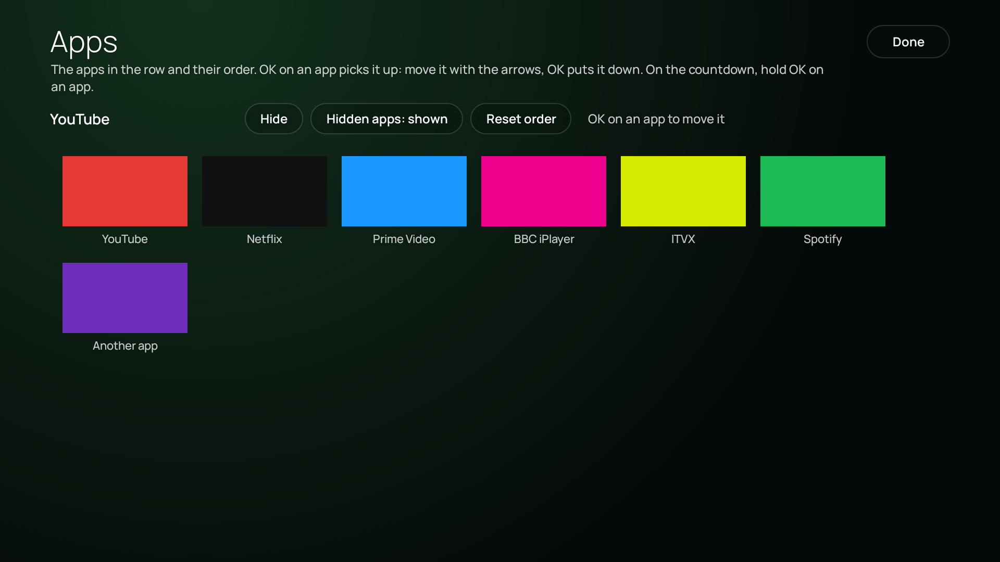
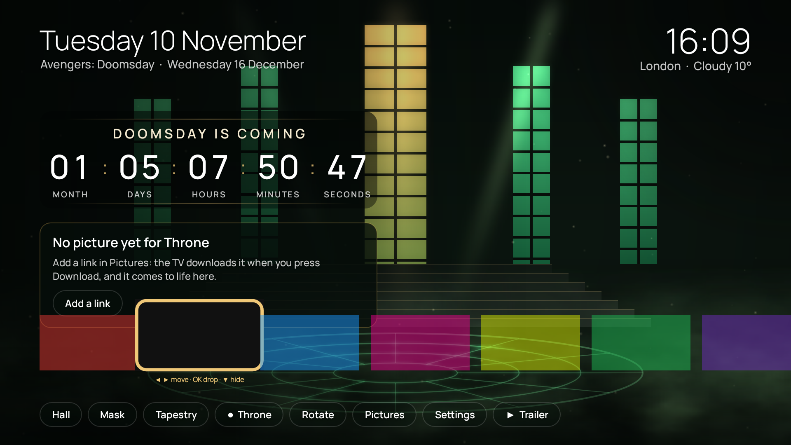
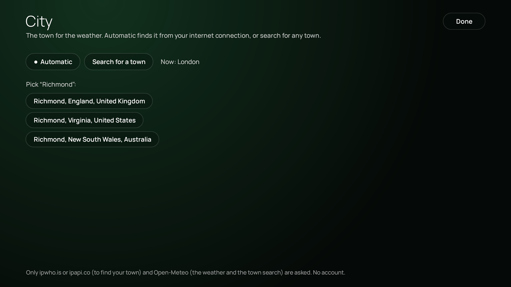

# Settings

Open **Settings** from the buttons along the bottom. Each choice is saved as soon as you press it.

| Setting | Choices | What it does |
|---|---|---|
| **Pictures** | Open Pictures | The four picture slots and their links ([PICTURES.md](PICTURES.md)). |
| **Apps** | Order and hide | Every app on the TV in the row's order. **OK on an app picks it up**: the arrows move it (Left/Right one place, Up/Down a row), **OK puts it down**, **Back puts it back**. OK on a hidden app shows it again. **Hide** hides the selected app; **Hidden apps: shown / not shown** and **Reset order** are along the top. On the countdown, **hold OK on an app** in the row: it lifts, Left/Right move it, OK drops it, Back cancels, Down asks to hide it. |
| **Rotate every** | 1 · 5 · 15 min | How often **Rotate** moves to the next picture. |
| **Clock** | 24-hour · 12-hour | The clock at the top right. |
| **Weather** | On · Off | The weather under the clock, from Open-Meteo, every 30 minutes. Hidden quietly when offline. |
| **City** | Choose a town | Where the weather is for. **Automatic** (the default) finds your town from your internet connection, once a day. Or **Search for a town**: type any town's name on the app's keyboard and pick it (towns with the same name show their region and country). |
| **Effects** | Full · Calm | Calm keeps the light, mist and dust but drops the energy jumps, the camera move and the automatic surges. Summon still works. |
| **Dim at night** | Off · 11 pm to 7 am | Darker and calm overnight. |
| **Ticking sound** | On · Off | A soft tick each second while the countdown is on screen. Never between 11 pm and 7 am, never in the screensaver. |
| **Screensaver** | Open TV settings · Preview | Google TV / Android TV only (Fire TV doesn't allow it). |
| **Home button** | Open Accessibility · Offer as home app | Make Home open Doomsday (see below). The first time the app opens it asks once; on boxes with a home choice it's offered as a home app from the start. |
| **About** | | The version. |

## The Home button

TVs differ in whether another app may be the home screen. The standard download has no
Accessibility helper (Play Protect blocks apps with one in some countries; see the FAQ), so on
Google TV and Fire TV the Home button needs the **-full** download:

| TV | How | Works? |
|---|---|---|
| **Google TV** (Chromecast with Google TV, Sony, TCL…) | **-full download only**: Settings → Home button → **Open Accessibility**, then switch on **"Doomsday opens when you press Home"** | Yes: Home shows Google TV's home for a moment, then Doomsday. |
| **Android TV boxes that let you pick a home app** (e.g. Nvidia Shield, many boxes) | Settings → Home button → **Offer as home app**, then press Home and choose Doomsday | Yes. |
| **Amazon Fire TV** | -full download: Open Accessibility as on Google TV | Maybe: Amazon's updates have been blocking home replacements. Try it; if Home still shows Fire TV's home, it isn't allowed on your model. |

If another app already does this (for example Avan, Projectivy or Button Mapper), Doomsday leaves
Home to it and Settings says so. Doomsday never changes a TV setting itself; turn it off the
same way you turned it on.

## The buttons on the countdown

Hall · Mask · Tapestry · Throne · Rotate · Pictures · Settings · Trailer. Press **up** from the
buttons for your TV's apps.

## Summon

Hold **OK** for two seconds on any button. A short press still just presses the button.
